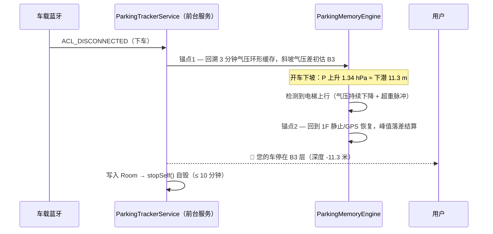
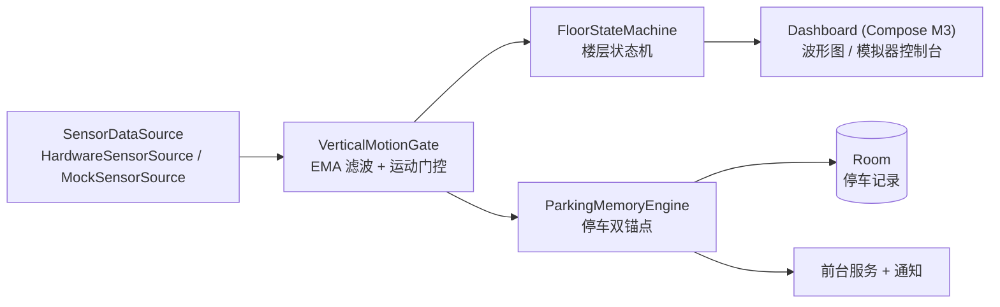

<div align="center">

# FloorSense 🏢🚗

**基于气压计的 Android 楼层定位与地下停车记忆**

不靠 GPS、不靠基站——只用一颗气压计，知道你在几楼、车停在哪层地下车库。

[](https://github.com/zd200572/FloorSense/actions/workflows/ci.yml)
[](LICENSE)
[](https://www.android.com/)
[](#-构建与测试)

</div>

---

## ✨ 功能特性

- **实时楼层追踪** — 电梯、楼梯、汽车坡道全场景识别，大字楼层随气压波形实时跳变
- **抗天气干扰** — 静止时锁死楼层：台风过境、空调新风造成的气压漂移被基准锚点动态吸收，绝不误跳层
- **地下停车记忆** — 开车进地库 → 车载蓝牙断开自动记录 → 乘电梯回 1F 自动精确结算，锁屏通知告诉你「车停在 B3（深度 -11.3m）」
- **双锚点结算** — 无 GPS 的地下车库场景：进库下坡环形缓存回溯做初估 + 回 1F 电梯行程峰值落差做精确确认
- **手动校准** — 「我现在在 6 楼，层高 3.2m」：一步锚定任意楼层，支持自定义层高模板（地上/B1 落差/地下三项）
- **模拟器控制台** — 内置台风过境、电梯往返、进 B3 车库回 1F、爬楼梯四类合成波形场景，无需爬楼即可演示与调试
- **省电自毁** — 停车采集前台服务在结算或 10 分钟超时后立即自毁，绝不后台常驻

## 🧭 工作原理

### 1. 相对气压测高，禁止绝对海拔裸算

近地面环境用线性近似把气压差换算为高度差，一切高度都相对于动态锁定的 1F 基准气压 `P_base`：

$$\Delta h = 44330 \times \left[ 1 - \left( \frac{P_{\text{smooth}}}{P_{\text{base}}} \right)^{\frac{1}{5.255}} \right] \approx -8.43 \times \Delta P \quad (\text{m/hPa})$$

### 2. 运动门控防漂移（Motion Gating）

| 状态 | 判据 | 行为 |
|---|---|---|
| 静止 | 无超重/失重脉冲，\|dP/dt\| 低 | **锁死楼层**，环境气压漂移反向修正进 `P_base` |
| 电梯 | \|a_z\| > 0.35 m/s² 脉冲 + 12s 惯性，\|dP/dt\| > 0.07/0.14 hPa/s | 冻结基准，ΔP 实时换算高度 |
| 楼梯/坡道 | 连续步伐或持续 0.05 hPa/s | 同上（区分于电梯防止误判） |

### 3. 地下停车双锚点



### 楼层命名跳过 0 层

内部索引 `0 = 1F`、`1 = 2F`、`-2 = B2`；地库采用非对称层高模型（1F→B1 含覆土/管线夹层，默认 4.2m；B2 起标准层高 3.3m），三档预设 + 自定义模板。

## 🏗️ 架构



领域层（`domain/`）为纯 Kotlin、零 Android 依赖，配合可互换的 Mock/硬件双数据源，**全部算法在纯 JVM 单元测试中回归**——包括「台风天静止不跳层」和「B3 停车闭环」两个核心场景。

## 🚀 构建与测试

```bash
# 纯 JVM 单元测试（无需真机）
./gradlew :app:testDebugUnitTest

# 打包 Debug APK
./gradlew :app:assembleDebug
```

- Android Studio（Ladybug+）直接打开即可；`local.properties` 指向本机 SDK 路径
- 技术栈：Kotlin 2.0 · Coroutines/StateFlow · Jetpack Compose (Material 3) · Room · DataStore · minSdk 26 · targetSdk 35
- Gradle wrapper 默认走腾讯镜像（`gradle/wrapper/gradle-wrapper.properties`），其他网络环境可改回官方源

## 📋 权限说明

| 权限 | 用途 |
|---|---|
| `BLUETOOTH_CONNECT` | 监听车载蓝牙断开（Android 12+） |
| `ACTIVITY_RECOGNITION` | 步态检测（楼梯/步行门控） |
| `POST_NOTIFICATIONS` | 停车结算通知（Android 13+） |
| `FOREGROUND_SERVICE(specialUse)` | 下车黄金 10 分钟采集 |

权限被拒时功能自动降级为纯气压速率门控，不会崩溃。服务遵循生命周期自毁：结算或 10 分钟超时立即 `stopSelf()`。

## 🔬 关键参数速查

| 参数 | 值 | 说明 |
|---|---|---|
| 气压-高度换算 | `Δh = -8.43·ΔP` | 近地面线性近似（15~20°C） |
| EMA 平滑系数 | α = 0.18 | 决策链路滤波（10Hz 采样） |
| 电梯脉冲阈值 | \|a_z\| > 0.35 m/s²，惯性 12s | 超重/失重识别 |
| 电梯气压速率 | 0.07（有惯性）/ 0.14 hPa/s | 门控判据 |
| 楼梯/坡道气压速率 | 0.05 hPa/s（或 ≥2 步 + 0.035） | 门控判据 |
| 停车服务自毁 | 结算即毁 / 最迟 10 分钟 | 省电铁律 |

## 🗺️ Roadmap

- [ ] Kotlin Multiplatform：领域层已平台无关，可平滑共享给 iOS（CMAltimeter ≈ 1Hz 需重新整定阈值）
- [ ] iOS 停车触发方案：快捷指令自动化 / BLE 信标（Android 的蓝牙广播+前台服务在 iOS 无对等物）
- [ ] 桌面小组件：锁屏直接显示「车停在 B3」
- [ ] 多建筑档案：按地理位置自动切换层高模板

## 📄 License

[MIT](LICENSE) © 2026 Dong Zhao
